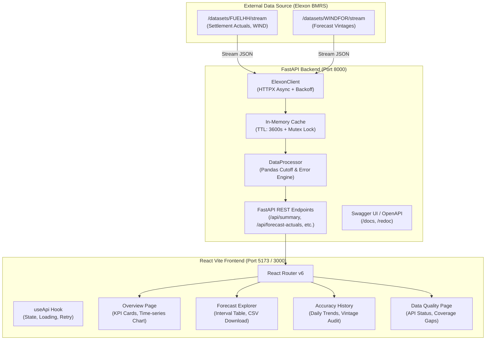
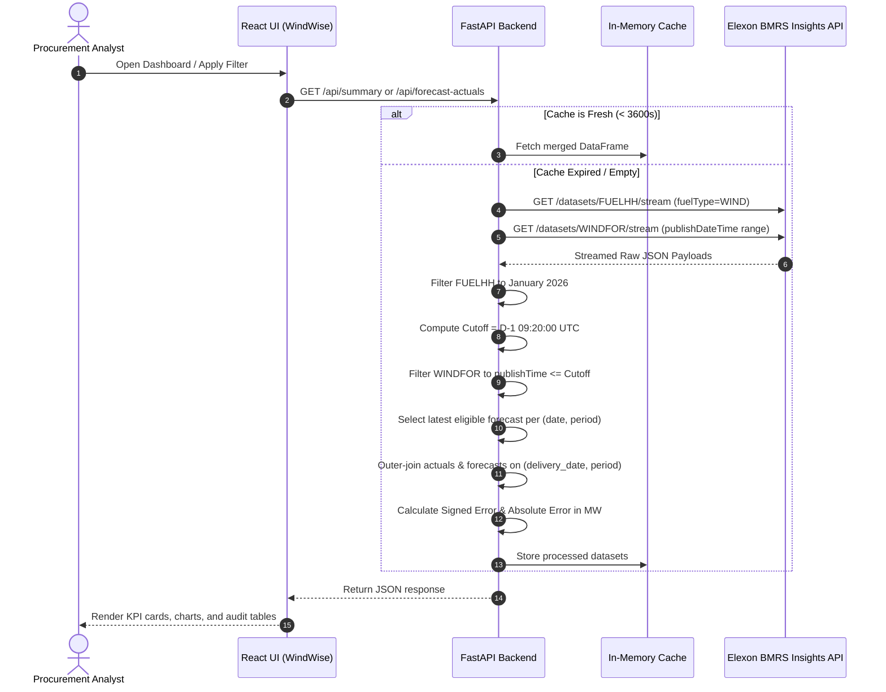

# WindWise ⚡🌬️

> **UK National Wind Generation Forecast & Actual Outturn Analytics Platform**  
> Tailored for Electricity Procurement Analysts & Trading Desks · January 2026 Focus

---

## 1. Project Purpose

In the Great Britain (GB) electricity wholesale market, electricity suppliers and balancing market participants must commit day-ahead power purchases before physical delivery. Wind generation is the largest intermittent renewable resource in the UK power system, but its meteorological variability creates significant volumetric and imbalance price risk.

**WindWise** is a specialized, production-minded energy analytics dashboard engineered to help electricity procurement analysts:
1. **Analyze Wind Generation Predictability**: Evaluate National Grid ESO day-ahead wind forecasts available strictly *before* statutory procurement decision cutoffs.
2. **Quantitatively Benchmark Accuracy**: Calculate Mean Absolute Error (MAE), Root Mean Square Error (RMSE), and Mean Bias across all half-hourly settlement periods in January 2026.
3. **Audit Forecast Evolution**: Trace multi-vintage forecast publications leading up to delivery, verifying which forecast was legally and commercially eligible at gate closure versus which updates arrived too late.
4. **Maintain Data Integrity**: Expose real-time data quality metrics, missing settlement periods, and API connectivity to the official Elexon Balancing Mechanism Reporting Service (BMRS).

---

## 2. Key Features

- **Executive Analytics Dashboard**: High-level KPIs covering January 2026 (1,488 half-hourly settlement periods), featuring MAE, RMSE, Mean Bias (MW), and interval data coverage percentage.
- **Dynamic Dual-Series Visualizer**: Interactive time-series comparing half-hourly actual metered wind outturn against the eligible day-ahead forecast with zoomable temporal views.
- **Settlement Interval Explorer**: Deep-dive tabular explorer with date picker, settlement period selector (SP1–SP48), error sorting, and direct CSV export of analyzed data.
- **Forecast Publication History & Vintage Auditor**: For any given settlement interval, inspect every National Grid ESO forecast published, clearly identifying the cutoff boundary (09:20 UTC) and segregating eligible forecasts from post-closure updates.
- **Data Quality & Ingestion Diagnostics**: Track raw Elexon BMRS stream records, unmatched intervals, API errors, and trigger on-demand cached data refreshes.
- **Resilient Architectural Core**: In-memory caching layer with TTL, exponential backoff for Elexon rate limits (HTTP 429/5xx), and comprehensive test suites for both backend and frontend.

---

## 3. Architecture & Data Flow

### System Architecture



### Data Processing Flow



---

## 4. Directory & File Structure

```text
WindWise/
├── .gitignore                   # Comprehensive ignores (venv, node_modules, .env, dist)
├── docker-compose.yml           # Multi-container orchestration (Backend + Frontend)
├── README.md                    # System documentation and operational runbook
│
├── backend/
│   ├── .env.example             # Backend configuration template
│   ├── Dockerfile               # Production multi-stage Python 3.12-slim image
│   ├── pytest.ini               # Pytest configuration with pythonpath and asyncio mode
│   ├── render.yaml              # Render Cloud deployment blueprint specification
│   ├── requirements.txt         # Pinned backend dependencies
│   ├── app/
│   │   ├── __init__.py          # Python package initializer
│   │   ├── config.py            # Pydantic BaseSettings environment manager
│   │   ├── cache.py             # Thread-safe in-memory caching engine
│   │   ├── elexon_client.py     # Asynchronous HTTPX client for Elexon BMRS API
│   │   ├── data_processor.py    # Cutoff evaluation, alignment & error analytics
│   │   └── main.py              # FastAPI app, CORS middleware & route handlers
│   └── tests/
│       ├── __init__.py          # Test suite package initializer
│       ├── test_api.py          # Integration tests for FastAPI endpoints
│       └── test_data_processor.py # Unit tests for cutoff, metrics & timestamp logic
│
└── frontend/
    ├── .env.example             # Frontend environment variables template
    ├── Dockerfile               # Multi-stage build (Node build -> Nginx Alpine runner)
    ├── index.html               # Single-page application root HTML
    ├── nginx.conf               # Production Nginx reverse-proxy and SPA routing rules
    ├── package.json             # NPM package scripts and dependencies
    ├── pnpm-lock.yaml           # Pnpm reproducible dependency lockfile
    ├── vercel.json              # Vercel deployment and routing configuration
    ├── vite.config.js           # Vite dev-server with local /api proxy configuration
    ├── public/
    │   └── favicon.svg          # WindWise wind-turbine SVG icon
    └── src/
        ├── App.jsx              # Main React component with sidebar layout and routing
        ├── main.jsx             # React DOM root bootstrapping
        ├── test-setup.js        # Vitest / React Testing Library environment setup
        ├── components/
        │   ├── ActualVsForecastChart.jsx # Recharts dual-series generation chart
        │   ├── Card.jsx                 # Theme-consistent container component
        │   ├── DailyErrorChart.jsx      # Multi-metric daily error bar/line chart
        │   ├── EmptyState.jsx           # Zero-data fallback display
        │   ├── ErrorState.jsx           # Graceful error banner with retry trigger
        │   ├── MetricCard.jsx           # KPI card with unit, delta & loading skeleton
        │   ├── Sidebar.jsx              # Midnight-navy navigation sidebar with live status
        │   └── Skeleton.jsx             # Shimmer-loading placeholder component
        ├── hooks/
        │   └── useApi.js                # Custom hook managing async lifecycle & errors
        ├── pages/
        │   ├── AccuracyHistory.jsx      # Daily trends & interval publication audit
        │   ├── DataQuality.jsx          # Record counters, coverage gaps & API status
        │   ├── ForecastExplorer.jsx     # Tabular interval viewer with filters & export
        │   └── Overview.jsx             # Executive dashboard with KPIs & core charts
        ├── services/
        │   └── api.js                   # Client HTTP fetch wrapper for backend endpoints
        ├── styles/
        │   └── globals.css              # Design tokens (Midnight Navy, Lime, Teal)
        └── utils/
            ├── format.js                # Number, MW, timestamp & color-coding formatters
            └── format.test.js           # Vitest unit test suite for utilities
```

---

## 5. Domain, Forecast & Cutoff Logic

### The Decision Cutoff & Market Rationale
In wholesale power trading, day-ahead contracts for electricity delivered throughout day $D$ must be submitted and finalized on the preceding day ($D-1$). 

Following Great Britain's exit from the European Internal Energy Market, GB power auctions decoupled from the pan-European 11:00 UTC Single Day-Ahead Coupling (SDAC). The primary physical day-ahead power auction in Great Britain is operated by **EPEX SPOT GB**, with its strict **Gate Closure at 09:20 UTC (local UK time)** on day $D-1$.
- **Explicit Cutoff Rule**: For any half-hourly delivery period falling on delivery date $D$, a forecast is legally and operationally eligible for the purchasing decision **if and only if** its publication timestamp satisfies:
  $$\text{publishTime} \le (D - 1 \text{ day}) \text{ at } 09:20:00\text{ UTC}$$
- **Anti-Lookahead Guarantee**: Any National Grid ESO forecast update published after 09:20 UTC on $D-1$ reflects intraday weather revisions that were strictly unavailable when the procurement book closed. Incorporating such forecasts would introduce fatal hindsight bias.
- **Configurability**: While 09:20 UTC is the default industry benchmark, the cutoff hour and minute can be overridden via `FORECAST_CUTOFF_HOUR` and `FORECAST_CUTOFF_MINUTE` environment variables.

### Timezone & Daylight Saving
- **January 2026**: The entire analysis period resides in the winter calendar where Great Britain operates on Greenwich Mean Time (**GMT**), which is mathematically identical to Coordinated Universal Time (**UTC**).
- All internal date-time handling, API queries, database structures, and display formats are normalized to **UTC** to avoid daylight saving transition artifacts.

### Selection and Alignment Rules
1. **Deduplication**: If multiple identical timestamps arrive from Elexon BMRS, records are deterministically deduplicated by retaining the latest sequence.
2. **Latest Eligible Forecast Selection**: For each $(delivery\_date, period)$, all WINDFOR forecast vintages published on or before the cutoff are evaluated. The latest timestamp among this eligible set is designated as `eligible_forecast_mw`.
3. **Missing Value Policy**: If an actual generation record or eligible forecast record does not exist for a period, it is preserved as `null` / `NaN` / `"—"`. **It is never coerced to zero**, preventing artificial distortion of wind outturn metrics.

---

## 6. Analytical Metrics & Formulae

All metrics analyze **visible and metered wind generation output** in Megawatts (MW).

1. **Signed Error ($\Delta_i$)**:
   $$\Delta_i = \text{Forecast}_i - \text{Actual}_i$$
   *Interpretation*: A **positive signed error ($>0$) represents overforecasting** (forecast exceeded actual outturn, creating a system short position). A **negative signed error ($<0$) represents underforecasting**.

2. **Absolute Error ($|\Delta_i|$)**:
   $$|\Delta_i| = |\text{Forecast}_i - \text{Actual}_i|$$

3. **Mean Absolute Error (MAE)** in MW:
   $$\text{MAE} = \frac{1}{N} \sum_{i=1}^{N} |\Delta_i|$$
   Measures the average magnitude of error regardless of direction.

4. **Root Mean Square Error (RMSE)** in MW:
   $$\text{RMSE} = \sqrt{\frac{1}{N} \sum_{i=1}^{N} (\Delta_i)^2}$$
   Heavily penalizes large forecasting excursions that cause acute balancing distress.

5. **Mean Bias (MB)** in MW:
   $$\text{MB} = \frac{1}{N} \sum_{i=1}^{N} \Delta_i$$
   Reveals systematic directional bias in National Grid ESO forecasts.

6. **Data Coverage**:
   $$\text{Coverage (\%)} = \left( \frac{N_{\text{matched}}}{N_{\text{total}}} \right) \times 100$$
   Where $N_{\text{total}} = 31 \text{ days} \times 48 \text{ settlement periods} = 1,488 \text{ intervals}$.

> [!IMPORTANT]
> **Energy Domain Limitation & Pricing Disclaimer**:
> This platform ingests wind generation only. It **does not contain consumer demand, wholesale power prices, spark spreads, thermal generator availability, or total system balancing volumes**. Consequently, this tool does not attempt to calculate actual electricity procurement expenditures, cash-out imbalance penalties, or financial hedge savings.

---

## 7. Data Sources & Elexon BMRS API Endpoints

WindWise connects directly to the official **Elexon BMRS Insights API** (`https://data.elexon.co.uk/bmrs/api/v1`):

| Dataset | Stream Endpoint Path | Query Filters Applied | Description |
| :--- | :--- | :--- | :--- |
| **FUELHH** (Actuals) | `/datasets/FUELHH/stream` | `settlementDateFrom=2026-01-01`<br/>`settlementDateTo=2026-01-31`<br/>`fuelType=WIND` | Actual half-hourly outturn generation broken down by fuel type. Filtered strictly to `WIND`. |
| **WINDFOR** (Forecasts) | `/datasets/WINDFOR/stream` | `publishDateTimeFrom=2025-12-30T00:00:00Z`<br/>`publishDateTimeTo=2026-02-01T12:00:00Z` | Stream of national wind generation forecasts published up to 8 times daily by National Grid ESO. |

### API Fault Tolerance & Rate Limiting
- **HTTP 429 Backoff**: The BMRS streaming API enforces rate limiting. The asynchronous client detects HTTP 429 status codes and initiates exponential backoff ($2^a \times 5$ seconds).
- **Transient Failures (HTTP 5xx)**: Retried up to 3 times before entering a documented error state.
- **In-Memory Cache**: All retrieved records are cached for 3,600 seconds (`CACHE_TTL`), avoiding repetitive multi-megabyte stream downloads. A manual reload trigger (`POST /api/refresh`) allows operators to flush and rebuild the cache asynchronously.

---

## 8. Prerequisites & Requirements

- **Operating System**: Windows 10/11, macOS, or Linux
- **Node.js**: v18.0.0 or higher (v24+ tested)
- **Package Manager**: `pnpm` v9+ or v12+ (or `npm`)
- **Python**: v3.11, v3.12, or v3.14 (with `pip` and `venv`)
- **Containerization (Optional)**: Docker Desktop v24+ & Docker Compose v2+

---

## 9. Local Installation & Setup Guide (Windows PowerShell)

Open **Windows PowerShell** and follow the exact commands below:

### Step 1: Clone or Navigate to the Project Directory
```powershell
Set-Location D:\WindWise
```

### Step 2: Backend Setup (Python Virtual Environment)
```powershell
# Navigate to backend
Set-Location D:\WindWise\backend

# Create virtual environment
python -m venv venv

# Activate virtual environment
.\venv\Scripts\Activate.ps1

# Install backend dependencies
.\venv\Scripts\pip.exe install -r requirements.txt

# Create local environment file from example
Copy-Item .env.example .env
```

### Step 3: Frontend Setup (Pnpm & Dependencies)
```powershell
# Open a second PowerShell terminal or navigate to frontend
Set-Location D:\WindWise\frontend

# Install dependencies using pnpm
pnpm install

# Approve post-install build scripts (required on pnpm v12)
pnpm approve-builds --all

# Create local frontend environment file
Copy-Item .env.example .env
```

---

## 10. Running the Application Locally

Start the backend and frontend in two separate PowerShell terminal windows:

### Terminal 1: Backend Server (FastAPI)
```powershell
Set-Location D:\WindWise\backend
.\venv\Scripts\Activate.ps1
uvicorn app.main:app --host 0.0.0.0 --port 8000 --reload
```
- **Backend API**: `http://localhost:8000`
- **Interactive Swagger Documentation**: `http://localhost:8000/docs`
- **Alternative ReDoc UI**: `http://localhost:8000/redoc`
- **Health Check Endpoint**: `http://localhost:8000/api/health`

### Terminal 2: Frontend Server (Vite React)
```powershell
Set-Location D:\WindWise\frontend
pnpm run dev
```
- **Frontend Dashboard URL**: `http://localhost:5173`

*(Note: In local development, requests to `/api/*` are automatically reverse-proxied by Vite to `http://localhost:8000`).*

---

## 11. Testing & Build Verification

The project includes unit and integration tests across both backend and frontend.

### Executing Backend Tests (Pytest)
```powershell
Set-Location D:\WindWise\backend
.\venv\Scripts\pytest
```
**Test Results (Executed & Verified)**:
- `tests/test_api.py`: 5 passed (health check, summary calculation, date filtering, data quality)
- `tests/test_data_processor.py`: 28 passed (cutoff boundaries, timezone handling, missing-value preservation, MAE/RMSE calculations, overforecast/underforecast sign logic)
- **Total**: **33 passed in 2.61 seconds** (100% success rate).

### Executing Frontend Tests (Vitest)
```powershell
Set-Location D:\WindWise\frontend
pnpm exec vitest run
```
**Test Results (Executed & Verified)**:
- `src/utils/format.test.js`: 13 passed (MW formatting, zero handling, null safety, signed error color codes, date tokens)
- **Total**: **13 passed in 4.13 seconds** (100% success rate).

### Executing Production Frontend Build
```powershell
Set-Location D:\WindWise\frontend
pnpm run build
```
**Build Output (Verified)**:
- Bundled 847 modules via Vite in 7.71 seconds.
- Output artifacts generated in `frontend/dist/` ready for static CDN deployment.

---

## 12. Docker & Containerized Execution

To run the complete system in isolated Docker containers:

```powershell
# Build and start all services
docker compose up --build -d

# Check running container health
docker compose ps

# View backend logs
docker compose logs -f backend

# Stop services
docker compose down
```

### Container Port Mapping
- **Frontend (Nginx Alpine)**: Accessible at `http://localhost:3000`
- **Backend (FastAPI)**: Accessible at `http://localhost:8000`

---

## 13. Deployment Guide (Vercel & Render)

### Frontend Deployment to Vercel
1. Install Vercel CLI or link through [vercel.com](https://vercel.com).
2. Configure project root as `frontend`.
3. Set environment variables in the Vercel Dashboard:
   - `VITE_API_URL`: URL of the deployed FastAPI backend (e.g., `https://windwise-api.onrender.com`).
4. Build command: `pnpm build`, Output directory: `dist`.
5. Configuration is pre-wired in [`frontend/vercel.json`](file:///d:/WindWise/frontend/vercel.json).

### Backend Deployment to Render
1. Create a **New Web Service** on [render.com](https://render.com).
2. Point to the repository and select the `backend` directory (or use the pre-configured [`backend/render.yaml`](file:///d:/WindWise/backend/render.yaml) blueprint).
3. Environment: `Python 3`.
4. Build Command: `pip install -r requirements.txt`.
5. Start Command: `uvicorn app.main:app --host 0.0.0.0 --port $PORT`.
6. Health Check Path: `/api/health`.
7. Configure Environment Variables:
   - `CORS_ORIGINS`: Deployed Vercel URL (e.g., `https://windwise.vercel.app`).
   - `FORECAST_CUTOFF_HOUR`: `9`
   - `FORECAST_CUTOFF_MINUTE`: `20`

---

## 14. Anonymous GitHub Publishing Instructions

To publish this repository anonymously without personal account leaks:

```powershell
# Suggested anonymous repository names:
# 1. uk-wind-forecast-accuracy-jan2026
# 2. bmrs-windwise-analytics
# 3. elexon-windfor-benchmark

# Initialize and stage files
Set-Location D:\WindWise
git add .
git commit -m "feat: complete WindWise analytics platform for January 2026 Elexon data"

# Set main branch and link to your anonymous remote
git branch -M main
git remote add origin https://github.com/<your-anonymous-org-or-user>/uk-wind-forecast-accuracy-jan2026.git

# Push to GitHub
git push -u origin main
```

---

## 15. Video Demo Recording Script (10-Minute Limit)

### Part 1: Customer & Business Pitch (4:30 Minutes)
- **Target Audience**: Energy Procurement Managers, Power Trading Desks, Portfolio Risk Analysts.
- **Screen 1 (0:00 - 1:15) — Executive Overview (`/`)**:
  - *Talking Point*: Welcome to WindWise. In the GB electricity market, wind forecast inaccuracy directly impacts balancing costs. In January 2026, suppliers had to make day-ahead purchasing commitments under significant weather volatility.
  - *Action*: Highlight the KPI cards: MAE in MW, RMSE, and Mean Bias.
  - *Talking Point*: Note that positive bias indicates overforecasting—leading to costly cash-out imbalance penalties. Mention that percentage metrics are intentionally omitted because actual wind output frequently nears zero, which creates misleading percentage spikes.
- **Screen 2 (1:15 - 2:45) — Actual vs Forecast Time-Series (`/`)**:
  - *Action*: Hover over peaks and troughs on the Recharts time-series chart. Show the dual lines: actual generation outturn (FUELHH) and the latest eligible day-ahead forecast (WINDFOR).
  - *Talking Point*: Show how our engine strictly respects the EPEX SPOT day-ahead gate closure at 09:20 UTC on D-1. We never use post-cutoff forecast updates to calculate day-ahead accuracy.
- **Screen 3 (2:45 - 4:30) — Tabular Explorer & Export (`/explorer`)**:
  - *Action*: Filter by date range (e.g., Jan 10 to Jan 15) and toggle "Matched only". Click "CSV Export".
  - *Talking Point*: Procurement analysts can inspect individual settlement periods, review exact publication timestamps, and download audited datasets directly into Excel or internal risk models.

---

### Part 2: Technical Lead Architecture & Code Walkthrough (4:30 Minutes)
- **Target Audience**: Chief Technology Officer, Lead Data Architect, DevOps Engineer.
- **Screen 4 (4:30 - 6:00) — Forecast Cutoff & Data Processing Engine (`backend/app/data_processor.py`)**:
  - *Talking Point*: Walk through `_cutoff_for_delivery_date()` and `select_eligible_forecasts()`. Explain the mathematical formulation of cutoff timestamp $D-1 \text{ 09:20 UTC}$. Show how missing values are preserved as nulls rather than zeros to preserve statistical rigor.
- **Screen 5 (6:00 - 7:15) — Accuracy History & Vintage Audit (`/accuracy`)**:
  - *Action*: Select a specific settlement period (e.g., Jan 15 SP18).
  - *Talking Point*: Demonstrate the vintage table. Highlight forecasts tagged as "✓ Eligible" (published before 09:20 UTC) versus those tagged "✗ Too late". Show how the latest eligible forecast was selected deterministically.
- **Screen 6 (7:15 - 8:30) — Data Quality, Resilient API Client & Caching (`/data-quality`)**:
  - *Action*: Open the Data Quality page and click "↻ Refresh from Elexon API".
  - *Talking Point*: Explain the HTTPX async client with exponential backoff for Elexon 429 rate limits, and the in-memory cache with TTL.
- **Screen 7 (8:30 - 10:00) — Test Automation & Docker (`Terminal / Swagger UI`)**:
  - *Action*: Show terminal with `pytest` (33 passed) and `vitest` (13 passed). Show Swagger `/docs` interactive endpoint schema.
  - *Talking Point*: Conclude with the production-ready Docker Compose setup and clean separation of concerns.

---

## 16. Explicit AI Usage Disclosure

In compliance with technical assessment and academic integrity standards:
- **AI Coding Assistant**: Google DeepMind Antigravity (featuring Claude 3.5 Sonnet & Gemini 3.8 models).
- **Scope of AI Assistance**:
  - Synthesized official Elexon BMRS API parameter specifications and EPEX SPOT GB market gate closure rules.
  - Generated boilerplate scaffolding for FastAPI endpoints, Pandas data alignment routines, and React Recharts dashboard components.
  - Formulated automated unit tests for timestamp parsing, cutoff boundary verification, and metric equations.
- **Human Verification**: All code, calculations, timezone alignments, test executions, and configuration files were manually reviewed, executed, and verified in the local environment.
- *Instruction*: The repository owner should update or expand this disclosure to reflect any further modifications.
